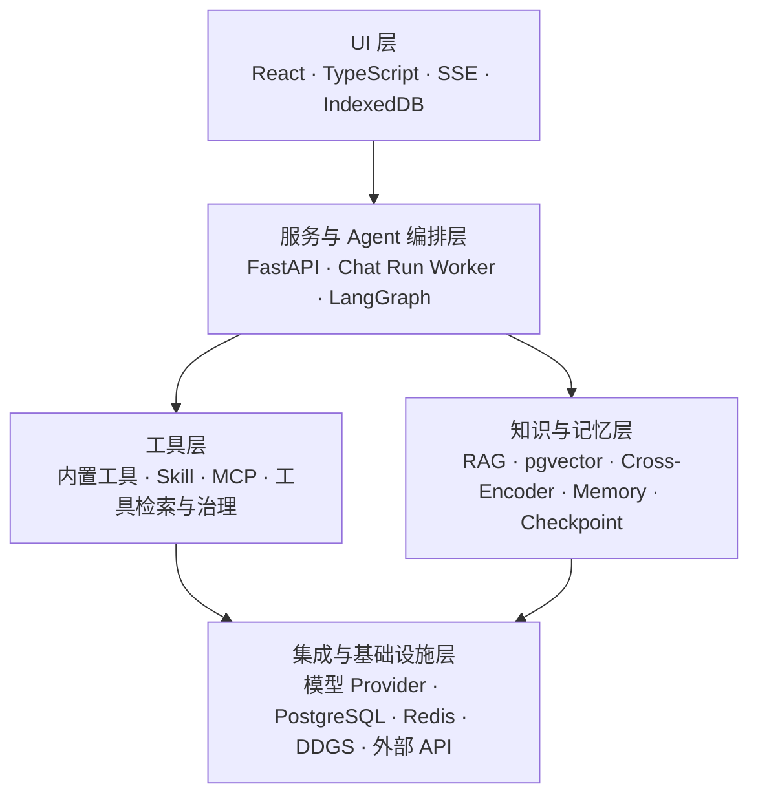
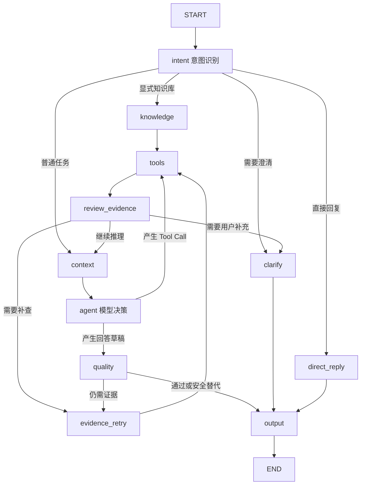

# 智行助手 Agent 项目详细说明书

## 1. 文档范围

本文说明智行助手当前代码的整体架构、主要模块、请求运行流程、状态与数据设计、生产治理能力以及涉及的技术知识点。内容以仓库现有实现为准，并明确区分：

- **默认可运行能力**：无需额外基础设施即可在本地使用。
- **配置后启用能力**：需要 PostgreSQL、Redis、Embedding、Cross-Encoder 或 MCP 等配置。
- **升级规划能力**：已进入生产升级台账，但还没有完全落入主执行链。

项目当前的核心定位是：以 React 提供中文聊天界面，以 FastAPI 暴露服务接口，以 LangGraph 编排一个有状态的主 Agent，通过本地工具、MCP、RAG、长期记忆和质量门完成“理解问题、决定行动、获取资料、校验结果、生成答案”的闭环。

## 2. 项目能力与边界

### 2.1 已实现的主要能力

- 普通知识问答、寒暄与澄清。
- 计算器、天气查询和公开网页搜索。
- 根据问题动态判断直接回答、调用工具、查询知识库或要求补充信息。
- 结构化意图识别、追问消解和受控复合任务规划。
- MCP 工具发现、白名单、参数校验、调用预算、超时和高风险审批。
- 本地 Skill 加载、触发词匹配和动态工具白名单。
- PostgreSQL + pgvector 知识库、混合检索、证据扩展与可选 Cross-Encoder 重排。
- SQLite/PostgreSQL 长期记忆，按用户隔离并支持显式保存、查询和删除。
- LangGraph Checkpoint、多轮上下文压缩和 PostgreSQL 断点恢复。
- SSE 流式事件、持久化 Chat Run、断流重连、取消和重试。
- JWT、访问密钥、限流、CORS、Prompt Override 检测和多实例配置检查。
- React 会话管理、账号级本地隔离、会话级草稿、流式进度、引用与 Markdown 展示。
- 单元测试、意图回归、RAG 回归、前端测试与 GitHub Actions CI。

### 2.2 当前边界

- 核心是**模块化单 Agent + 固定 LangGraph 骨架**，不是多个长期驻留 Agent 自动协作的平台。
- 模型可以动态决定是否调用工具，但工作流节点和安全边界由后端代码确定。
- Java Service 当前只是可选业务服务基础框架，不在 React 到 Python Agent 的默认请求链路中。
- 当前高风险 MCP 审批通过独立确认接口续答；LangGraph 原生 `interrupt/Command(resume)` 仍属于升级项。
- 长期记忆表预留了向量字段，但当前记忆检索主要使用关键词与近期记录；完整向量检索主要用于知识库。
- 未配置 PostgreSQL 时，Checkpoint 只保存在当前进程，不能跨重启恢复。
- 未配置 Embedding 时，知识库退化为关键词检索；未配置本地 Cross-Encoder 时使用规则排序。

## 3. 技术栈

| 领域 | 技术 | 作用 |
| --- | --- | --- |
| 前端 | React 19、TypeScript、Vite | 构建聊天页面、会话状态和流式交互 |
| UI | Ant Design、Ant Design X、Lucide | 输入框、弹窗、聊天组件和图标 |
| 内容渲染 | react-markdown、remark-gfm | 渲染标题、列表、表格、代码和引用 |
| API | FastAPI、Uvicorn | 提供认证、聊天、SSE、健康检查和审批接口 |
| Agent | LangChain、LangGraph | 模型抽象、工具协议、状态图和 Checkpoint |
| 模型 | OpenAI、Ollama、Anthropic、Google 适配器 | 通过统一工厂切换模型提供商 |
| 搜索 | DDGS、可选 DeepSeek Fetch | 搜索公开网页并按需补充正文 |
| MCP | MCP、langchain-mcp-adapters | 发现和调用受治理的外部工具 |
| 数据库 | PostgreSQL 16、pgvector | Checkpoint、Chat Run、知识库、长期记忆和向量索引 |
| 本地存储 | SQLite、IndexedDB | 本地记忆、审批和浏览器聊天快照 |
| 缓存与协调 | Redis | 多实例限流、Embedding L2 缓存、SingleFlight 等共享状态 |
| Java | Java 17、Spring Boot、WebFlux、Actuator | 可选业务 Service 和 Python Agent 适配层 |
| 测试 | unittest、Vitest、GitHub Actions | 后端、前端、检索和意图回归 |

## 4. 五层架构



### 4.1 UI 层

**主要职责**

- 接收用户输入并展示用户消息、助手回答、查询过程和引用。
- 管理会话、新建、重命名、归档、草稿和生成状态。
- 读取 SSE 事件，增量更新工具、计划、来源和回答内容。
- 在刷新或断流后使用 `run_id + event_id` 恢复服务端任务。
- 检查访问密钥、登录状态和后端连接状态。
- 按账号隔离 IndexedDB 中的聊天快照。

**主要模块**

| 模块 | 职责 |
| --- | --- |
| `features/chat/index.tsx` | 组合聊天页面、侧栏、消息区、输入框和连接设置 |
| `useChatSessions.ts` | 会话列表、活动会话、归档、重命名和会话级草稿 |
| `useChatMessages.ts` | 发送、重试、重新生成、恢复和审批交互 |
| `useAgentStream.ts` | 每个会话独立维护 AbortController、Run ID 和停止逻辑 |
| `agentApi.ts` | 调用认证、聊天、重连、取消和审批接口 |
| `sessionStorage.ts` | 账号级存储键、IndexedDB 持久化和快照合并 |
| `messageEvents.ts` | 把 SSE 事件转换为前端消息、工具过程和计划状态 |
| `MessageList` | 消息渲染、自动跟随、上滑停止跟随和跳到最新 |
| `AnswerMarkdown` | 安全渲染 Markdown、GFM 表格和来源链接 |

**涉及知识点**

- React Hook、状态提升、组件拆分和懒加载。
- TypeScript 联合类型和事件协议建模。
- SSE 流解析、断线游标恢复和 AbortController。
- IndexedDB 异步存储、快照合并和账号隔离。
- 并发 UI 状态：每个会话独立草稿、独立 Run、独立停止按钮。
- XSS 与内容安全：限制 Markdown 元素并过滤链接协议。

### 4.2 服务与 Agent 编排层

**主要职责**

- 对 HTTP 请求进行访问密钥、JWT、限流和输入校验。
- 创建持久化 Chat Run，异步执行任务并记录事件。
- 构建 LangGraph，连接意图、上下文、模型、工具、证据和质量节点。
- 维护同一会话顺序，避免两条消息并发覆盖 Checkpoint。
- 将运行过程转换为 SSE，支持断线重连、取消和历史恢复。

**主要模块**

| 模块 | 职责 |
| --- | --- |
| `api/server.py` | FastAPI 入口、认证、聊天、SSE、取消、审批、健康和指标 |
| `api/chat_run_store.py` | PostgreSQL Chat Run、幂等提交、事件游标和最终状态 |
| `api/chat_run_worker.py` | 脱离浏览器连接执行任务，恢复中断 Run |
| `agent/service.py` | 装配模型、工具、记忆、MCP 和 LangGraph |
| `agent/turn_gate.py` | 进程内队列或 PostgreSQL Advisory Lock 会话串行化 |
| `agent/turns.py` | Checkpoint 配置、单轮调用和流式事件转换 |

**涉及知识点**

- FastAPI 依赖与中间件、Pydantic 请求模型、HTTP 状态码。
- 后台 Worker、持久任务队列、租约式恢复与取消传播。
- 数据库事务、唯一约束、幂等键和 Advisory Lock。
- SSE 事件 ID、游标重放、Keep-Alive 和最终事件原子提交。
- 同会话串行、不同会话并行的并发控制模型。

### 4.3 工具层

**主要职责**

- 注册计算器、天气、网页搜索、知识库、记忆和 Skill 工具。
- 从受控 MCP 配置中发现外部工具。
- 根据意图、Skill、权限和相关性裁剪模型可见工具。
- 校验参数、风险、预算、超时和重试。
- 将失败结果与有效证据分离。

**内置工具**

| 工具 | 作用 | 关键约束 |
| --- | --- | --- |
| `calculator` | 基础算术计算 | 使用 AST 白名单，不允许名称、函数或属性访问 |
| `get_weather` | 当前天气和 1～7 天预报 | 规范地点和日期，调用固定天气 API |
| `web_search` | 搜索公开网页 | 只保留 HTTP/HTTPS 来源并限制结果数量 |
| `search_knowledge_base` | 查询内部知识库 | 只有配置知识库后注册，按用户和 ACL 过滤 |
| `remember_memory` | 保存长期记忆 | 必须由用户明确要求，拒绝疑似敏感值 |
| `recall_memory` | 查询当前用户记忆 | 按用户隔离 |
| `forget_memory` | 删除指定记忆 | 校验记忆归属 |
| `list_skills` | 查看受控技能 | 只读取项目内 Skill 目录 |

**涉及知识点**

- LangChain Tool Calling 和 JSON Schema。
- AST 安全求值与最小权限设计。
- 动态工具白名单和 Top-K 工具召回。
- 参数校验、输出清洗、超时、有限重试和循环预算。
- Tool Call 与 Tool Result 的 ID 配对和消息协议完整性。

### 4.4 知识与记忆层

**主要职责**

- 导入多种格式文档并结构化切片。
- 使用向量和全文检索召回候选片段。
- 融合、重排、邻居扩展并按 Token 预算打包证据。
- 保存用户显式长期记忆。
- 保存完整 Checkpoint，同时只向模型提供预算内上下文。

**涉及知识点**

- RAG、Embedding、pgvector、HNSW 和 PostgreSQL 全文检索。
- Chunk、父子/邻居上下文、语义完整性与引用定位。
- RRF、多阶段重排、Cross-Encoder 和检索评估。
- 短期状态、对话历史、长期记忆和企业知识的边界。
- 上下文窗口、Token 预算、滚动摘要和工具消息原子性。

### 4.5 集成与基础设施层

**主要职责**

- 统一创建不同 Provider 的聊天模型。
- 管理 PostgreSQL、Redis、SQLite 和外部服务。
- 连接 DDGS、天气、MCP 和可选正文抓取服务。
- 提供 Docker Compose 本地基础设施。

模型通过 `MODEL_PROVIDER`、`MODEL_NAME`、`MODEL_BASE_URL` 和温度配置切换。当前支持 OpenAI、Ollama、Anthropic 和 Google；DeepSeek 可以通过 OpenAI 兼容地址接入，现有适配会关闭其思考模式以保持标准 Tool Call 协议。

**涉及知识点**

- Adapter/Factory 模式和依赖倒置。
- Provider 能力差异、工具协议和上下文窗口适配。
- 连接池、缓存、熔断、限流和配置外置化。
- Docker 数据卷、健康检查、最小暴露端口和持久化。

## 5. LangGraph 工作流

### 5.1 图结构



### 5.2 节点职责

| 节点 | 输入 | 处理 | 输出 |
| --- | --- | --- | --- |
| `intent` | 用户消息、历史、能力摘要 | 追问消解、规则分类、语义路由、任务拆分 | `intent`、白名单、计划 |
| `clarify` | 澄清原因 | 生成明确追问 | 助手澄清消息 |
| `direct_reply` | 寒暄或简单固定意图 | 不调用模型或工具直接回复 | 助手消息 |
| `knowledge` | 显式知识库请求 | 准备知识库 Tool Call | 工具调用消息 |
| `context` | 完整 Checkpoint 历史 | 预算计算、最近回合选择、旧历史摘要 | 模型可见上下文 |
| `agent` | 上下文、意图、候选工具 | 装配 Prompt，调用模型决定回答或工具 | 草稿或 Tool Call |
| `tools` | Tool Calls、白名单、预算 | 权限与参数校验，执行本地/MCP 工具 | Tool Messages |
| `review_evidence` | 工具结果和计划 | 判断证据是否充分、是否补查或澄清 | 复核动作 |
| `evidence_retry` | 缺失证据与新查询 | 构造定向补查调用 | 新 Tool Call |
| `quality` | 草稿和本轮证据 | 时效、数值、天气、引用和高风险校验 | 通过答案或安全替代 |
| `output` | 已批准答案 | 分块写出 Token 事件 | 最终 SSE 内容 |

### 5.3 为什么不是纯 ReAct

项目保留了 ReAct 的核心思想：模型根据当前观察决定调用工具，工具结果再回到模型继续推理。但外围使用确定性的 LangGraph 节点控制意图、预算、证据和输出，形成“确定性骨架 + 局部模型决策”。这样比纯 ReAct 更容易限制循环、恢复 Checkpoint、测试节点和审计错误。

## 6. Agent State 设计

`AgentState` 继承 LangGraph `MessagesState`。消息字段由 LangGraph Reducer 管理，其他字段保存当前工作流决策。

| 字段 | 含义 |
| --- | --- |
| `messages` | 用户、模型和工具消息的协议序列 |
| `intent` | 本轮解析后的意图、查询、技能和任务计划 |
| `allowed_tool_names` | 本轮允许模型调用的工具白名单 |
| `tool_calls_used` | 已使用的整轮工具额度 |
| `evidence_retries` | 已进行的证据补查次数 |
| `evidence_retry_query` | 下一次定向补查查询 |
| `evidence_action` | 回答、补查、澄清或部分交付 |
| `evidence_missing` | 当前缺失的关键证据 |
| `evidence_table/details` | 供最终答案组织表格和补充信息的结构化证据 |
| `plan_outcomes` | 复合任务各子任务结果 |
| `conversation_summary` | 较早对话的结构化摘要 |
| `summary_message_count` | 已被摘要覆盖的消息数量 |
| `draft_answer` | 尚未通过质量门的模型草稿 |
| `context_limit_reached` | 本轮上下文是否无法安全压入模型窗口 |
| `durable_run_id` | 持久化 Chat Run 标识 |

State 设计遵循三个原则：

1. **协议数据和业务决策分离**：消息保持 Provider 合法，计划和复核放在结构化字段。
2. **Checkpoint 可恢复**：补查次数、计划结果和摘要游标必须进入 State，不能只保存在局部变量。
3. **避免无限膨胀**：大正文和大工具结果应裁剪或外置；模型只看摘要、最近完整回合和本轮证据。

## 7. 从用户提问到答案的完整流程

### 7.1 请求进入前端

1. 用户在 Composer 输入问题。
2. 前端为用户消息和助手占位消息分别生成 UUID。
3. `useAgentStream` 检查当前会话是否已有运行任务。
4. 前端调用 `/chat/stream`，携带 `thread_id`、`message_id`、重试标记、访问密钥和 Bearer Token。

### 7.2 API 接入与身份校验

1. 校验 API Key、CORS、请求大小、请求频率和 JWT。
2. 从 JWT 获取可信 `user_id`，而不是相信模型或请求体中的用户身份。
3. 检测直接覆盖系统提示词的输入。
4. 检查模型配置是否可用。
5. 配置持久 Chat Run 时，将请求以幂等 ID 写入 `chat_runs`；否则在当前请求内执行。

### 7.3 会话顺序控制

同一 `user_id + thread_id` 的消息不能同时修改 Checkpoint：

- 单实例使用进程内会话队列。
- PostgreSQL 模式使用 Advisory Lock。
- Chat Run Store 只允许同一会话中最早的待处理任务先被 Worker 领取。
- `message_id/request_id` 唯一约束阻止重试创建重复问题。

### 7.4 意图识别

意图识别采用混合方案：

1. 确定性规则识别寒暄、计算、天气、记忆、联网、知识库和显式 Skill。
2. 追问解析结合近期消息和上一轮意图，补全“帮我查证”“那适合吗”等省略对象。
3. 后端生成能力摘要，告诉语义模型当前有哪些工具、知识库是否可用、剩余预算和是否允许联网。
4. 语义模型使用结构化输出选择 `direct/search/tools/clarify`，并可生成改写问题和多个查询词。
5. 后端再次用规则验证模型改写，避免删除高风险语义、违反“不联网”要求或选择不存在的能力。
6. 复合任务解析为有限的只读任务计划，条件任务先执行前置工具再判断后续节点。

### 7.5 上下文构建

1. Checkpoint 保留完整历史，用于恢复和审计。
2. 模型输入按上下文窗口减去回答预留量得到预算。
3. 最近完整回合优先保留，不能拆坏 Tool Call 与 Tool Result 配对。
4. 较早历史合并为结构化摘要。
5. 相关长期记忆作为补充背景加入。
6. 当前用户问题和本轮工具证据拥有最高优先级。

### 7.6 模型决策

模型节点获得：

- 分层 System Prompt。
- 当前问题和预算内历史。
- 匹配到的 Skill 规则。
- 后端筛选后的候选工具，而不是全部工具。
- 剩余工具次数和风险约束。

模型只有两类有效输出：生成回答草稿，或发起原生 Tool Call。DeepSeek 兼容模式关闭思考字段，是为了避免非标准工具协议破坏消息配对。

### 7.7 工具执行

工具执行前依次检查：

1. 工具是否在当前白名单中。
2. 是否超过单批和整轮调用额度。
3. 重试或恢复场景是否禁止再次执行有副作用工具。
4. MCP 服务和工具是否在注册策略中。
5. 参数名、类型、长度和范围是否合法。
6. 风险等级是否需要审批。
7. 超时、有限重试和输出长度是否符合策略。

工具失败会形成结构化错误 Tool Message，保留可观测性但不会成为有效证据。

### 7.8 证据复核和补查

工具返回后，证据节点检查：

- 是否取得与问题相关的可引用资料。
- 地点、日期、事件和数值是否匹配。
- 多个子任务是否都已完成。
- 是否还存在关键证据缺口。
- 新查询是否与已搜索查询重复。
- 补查是否仍在次数和工具预算内。

系统最多进行有限补查；补查没有新增有效摘录时，使用现有资料部分交付或明确说明缺口，避免无限搜索。

### 7.9 回答生成和质量门

模型将有效工具结果或知识证据组织成自然语言草稿。质量节点随后执行：

- 天气地点和日期匹配。
- 联网事实是否存在可引用来源。
- 数字、日期、指标和方向是否得到证据支持。
- 引用编号是否能映射到具体 URL。
- 输出是否包含异常工具协议、危险内容或无效格式。
- 复合任务是否覆盖应回答的子任务。

草稿不会直接输出；通过质量门或被替换为安全说明后，`output` 节点才分块发送 Token 事件。

### 7.10 前端交付

前端根据事件类型更新消息：

- `progress`：当前阶段。
- `intent`：意图与路由摘要。
- `tool_start/tool_end`：工具执行状态。
- `plan`：复合任务步骤。
- `sources/pages`：来源与读取页面。
- `quality`：校验结果。
- `token`：已批准答案片段。
- `done/error`：最终状态。

最终答案通过 Markdown 渲染，表格可横向滚动，来源单独展示并可点击。

## 8. 典型业务流程

### 8.1 普通直接问答

```text
用户问题 → 意图允许直答 → 上下文压缩 → 模型生成 → 质量门 → SSE 输出
```

适合稳定知识、解释、写作和不需要外部事实的请求。它避免不必要的搜索，降低延迟和 Token 成本。

### 8.2 天气与穿衣建议

```text
识别地点/日期/活动 → get_weather → 校验地点和日期
→ 模型基于已核验预报生成活动与穿衣建议
→ 模型失败时使用确定性规则建议 → 输出预报与建议
```

关键点是工具负责事实，模型负责结合用户场景生成建议；模型不能改写或编造天气数值。

### 8.3 联网查询

```text
识别时效需求 → 生成一个或多个查询 → 搜索公开网页
→ 去重与结果预算 → 可选正文抓取 → 相关段落提取
→ 证据复核 → 必要时定向补查 → 跨来源总结并附引用
```

公开搜索结果总量受预算控制。网页内容被视为不可信数据，不能修改系统策略或工具权限。

### 8.4 知识库 RAG

```text
显式知识库问题 → ACL 过滤 → 查询 Embedding
→ 向量召回 + PostgreSQL 全文召回 → RRF 融合
→ 规则/Cross-Encoder 重排 → 同章节邻居扩展
→ Token 预算打包 → 模型基于 evidence 回答 → knowledge:// 引用
```

知识库只返回当前活动文档版本，并在同一文档、同一章节和权限范围内扩展相邻片段。

### 8.5 复合任务

例如“查询明天杭州天气，如果下雨就推荐室内景点并给穿衣建议”：

1. 意图节点拆出天气前置任务和条件搜索任务。
2. 先执行天气工具。
3. 根据真实降雨结果判断是否激活室内景点任务。
4. 未执行的原始任务优先获得剩余工具额度。
5. 每个子任务可记录成功、失败、跳过或部分完成。
6. 最终模型按计划结果合并答案。

当前实现属于受控任务计划，不是任意复杂度的动态 DAG 调度平台。

### 8.6 长对话

```text
完整历史进入 Checkpoint
→ 按完整回合切分
→ 最近回合保留原文
→ 较早历史生成结构化摘要
→ 合并长期记忆和当前问题
→ 校验不超过模型窗口
```

摘要失败时使用确定性压缩，避免因为摘要模型异常导致整个会话不可用。

### 8.7 断流重连与恢复

1. 后端返回 `run_id`。
2. 每个持久事件获得递增 `event_id`。
3. 前端持续保存最后事件游标。
4. 断流或刷新后调用 `/chat/runs/{run_id}/events?after={event_id}`。
5. 服务端只重放游标之后的事件。
6. Worker 崩溃后，新 Worker 根据 Run 状态和 LangGraph Checkpoint 恢复。
7. 最终 Token、`done` 事件和 Run 完成状态在事务内提交，避免显示完成却缺少答案。

### 8.8 MCP 高风险审批

当前实现流程是：

```text
模型请求 L2+ MCP 工具 → 后端生成一次性审批记录和脱敏参数预览
→ SSE 展示审批卡片 → 用户确认 → 确认接口原子消费令牌
→ 重新加载治理配置并复核工具/参数 → 执行工具
→ 工具结果重新进入受控模型续答和质量校验 → 返回结果
```

审批记录默认有有效期，一次性令牌以哈希形式保存。当前流程不是原生 LangGraph `interrupt/resume`；原生持久审批节点已列入升级台账。

## 9. 意图识别与任务规划

### 9.1 三层识别策略

| 层次 | 作用 | 优点 |
| --- | --- | --- |
| 规则分类 | 识别明确天气、计算、联网、记忆、知识库和寒暄 | 快、可解释、无需额外模型成本 |
| 语义模型 | 对模糊长句做结构化路由、改写和实体提取 | 灵活，能覆盖规则之外的表达 |
| 后端复核 | 验证能力、风险、“不联网”约束和工具可用性 | 防止模型选择不存在或不允许的能力 |

### 9.2 能力摘要

首次语义路由不是在真空中判断，而是接收后端生成的能力摘要，包括：

- 当前注册工具和描述。
- 当前回合是否允许公开搜索。
- 知识库是否配置和是否对本轮开放。
- 剩余工具次数和单批上限。
- 恢复场景中被禁止重放的工具。

这使模型根据“用户消息 + 会话上下文 + 当前环境能力”决定下一步，同时最终权限仍由后端控制。

### 9.3 任务拆分

复合问题可以拆为多个只读子任务，并描述依赖和条件。任务计划会经过结构校验和预算检查；执行阶段根据真实结果推进，而不是完全相信模型预先假设。

涉及知识点：结构化输出、实体提取、Query Rewrite、Follow-up Resolution、规则与模型混合路由、计划校验和条件执行。

## 10. 工具检索、Skill 与动态白名单

工具较少时可以全部提供给模型；工具增多后，项目采用两阶段选择：

1. 先根据用户、意图、Skill 和治理策略生成允许调用的工具集合。
2. 再按名称、描述和问题相关性召回 Top-K 候选提供给模型。

“工具检索”解决相关性和上下文长度问题，“动态白名单”解决权限与业务边界问题。即使工具检索错误召回了某个工具，只要它不在白名单中，执行节点仍会拒绝。

Skill 是项目内受控的 `SKILL.md`，声明名称、描述、触发词、允许工具、所需上下文和工作准则。Skill 只从固定目录加载，用户输入不能指定任意本地路径或远程 Skill，从而避免指令供应链风险。

## 11. MCP 架构与治理

`backend/config/mcp.json` 同时描述连接和治理策略：

- `mcpServers`：命令、参数和传输方式。
- `allowedServers`：允许启动的服务。
- `serverPolicies`：服务命令和隔离要求。
- `toolPolicies`：工具风险、参数规则、超时和重试。
- `maxToolCalls/maxToolBatch`：整轮和单批调用预算。

MCP 工具发现后使用前缀加入统一工具空间，并与本地工具走同一 Agent 流程。生产隔离模式可要求 MCP 运行在容器中；当前 stdio MCP 本质上是本机子进程，因此只能加载受信配置。

涉及知识点：MCP Client/Server、stdio 传输、工具发现、Schema 校验、风险分级、Human-in-the-loop、审计、超时、重试和沙箱边界。

## 12. RAG 知识库

### 12.1 文档导入

支持 TXT、Markdown、JSON、HTML、PDF、DOCX 和 XLSX。导入时执行：

1. 校验文件类型和大小。
2. 提取文本及标题、页码或工作表等结构信息。
3. 计算文档内容 Hash，并按所有者与来源做版本判断。
4. 使用 `structure-v4` 按章节、段落、句子、列表和表格行切分。
5. 只在同一章节内创建重叠窗口。
6. 原始正文单独保存，标题路径加入 `contextual_content` 用于检索。
7. 生成 Embedding 并保存到 pgvector。
8. 新版本激活后归档旧版本，检索只使用活动版本。

### 12.2 混合检索

知识库并行使用：

- pgvector 余弦相似度召回。
- PostgreSQL `tsvector + GIN` 全文召回。
- RRF 融合两个排序列表。
- 中文二元词和英文词面覆盖率加分。
- 向量阈值或关键词覆盖阈值作为证据准入门槛。

### 12.3 两阶段重排

- 无本地模型时使用可解释规则排序。
- 配置 Cross-Encoder 后，第一轮对候选片段重排。
- 第二轮对入围片段扩展出的同章节证据组再次重排。
- 超时、繁忙或模型不可用时回退规则顺序，不阻断问答。

### 12.4 ACL 与引用

- `private` 文档只允许所有者检索。
- `shared` 文档允许其他用户访问。
- SQL 查询必须先应用用户与访问范围过滤。
- 每个片段携带 `knowledge://文档ID#片段` 引用。
- 文档正文属于不可信资料，只能提供事实，不能改变系统规则。

### 12.5 Embedding Gateway

Embedding 统一经过 Gateway，实现：

- 文本规范化和版本化缓存键。
- 按条数和 Token 双阈值分批。
- 全局和租户 RPM/TPM 限流。
- 最大并发控制。
- 指数退避有限重试。
- Circuit Breaker。
- 进程内 L1 与 Redis L2 缓存。
- 单实例和跨实例 SingleFlight。
- 按租户主动失效缓存。

涉及知识点：缓存一致性、Cache Key 设计、限流、熔断、批处理、SingleFlight、多租户隔离和模型版本迁移。

## 13. 记忆、上下文与 Checkpoint

### 13.1 三类信息的区别

| 类型 | 保存内容 | 生命周期 | 存储 |
| --- | --- | --- | --- |
| 当前 State | 本轮消息、意图、工具、补查和草稿 | 单次图运行 | LangGraph State |
| 会话历史/Checkpoint | 多轮消息和节点状态 | 会话级，可恢复 | MemorySaver 或 PostgreSQL Saver |
| 长期记忆 | 用户明确要求保存的偏好和事实 | 跨会话，有 TTL | SQLite 或 PostgreSQL |
| 企业知识 | 文档、制度和业务资料 | 文档版本级 | PostgreSQL + pgvector |

### 13.2 长期记忆治理

- 只有明确“记住”才保存。
- 最长 500 字符。
- 检测密钥、密码、Token、银行卡和手机号等敏感模式。
- 所有操作绑定当前用户。
- 默认保留 365 天，可配置 TTL。
- SQLite 物理删除，PostgreSQL 使用 `deleted_at` 软删除。

### 13.3 Checkpoint

Checkpoint 保存图在执行边界的状态，并使用 `user_id:thread_id` 隔离会话。配置 PostgreSQL 后可跨进程和重启恢复；本地 MemorySaver 只适合开发。

Checkpoint 不能自动保证外部写操作恰好一次。如果工具成功后、Checkpoint 写入前进程崩溃，恢复时可能重试工具。因此生产写工具仍需要幂等键、执行记录和结果未知对账。

## 14. 模型适配

模型工厂屏蔽 Provider 初始化差异。主流程依赖 LangChain Chat Model 接口，不直接依赖某一家 SDK。

切换模型时主要调整：

```text
MODEL_PROVIDER
MODEL_NAME
MODEL_BASE_URL
MODEL_TEMPERATURE
对应 Provider API Key
```

不同模型仍需评估：

- 是否支持原生工具调用。
- 工具消息配对格式。
- 上下文窗口。
- 结构化输出稳定性。
- 流式内容块格式。
- Tokenizer、成本、限流和延迟。

涉及知识点：工厂模式、Adapter、依赖倒置、Provider Capability Matrix 和协议契约测试。

## 15. 安全与权限

### 15.1 身份链路

- `X-Agent-Api-Key` 用于保护服务入口。
- JWT Bearer Token 表示用户身份和角色。
- 生产 JWT 使用 Issuer、Audience、过期时间和至少 32 字符密钥。
- Bootstrap 密码使用 PBKDF2-SHA256 哈希，不保存明文。
- 登录接口和聊天接口使用独立限流。

### 15.2 数据隔离

- 会话和 Chat Run 查询强制带 `user_id`。
- Checkpoint 使用用户和线程组合键。
- 长期记忆按用户过滤。
- 知识库按所有者和 `private/shared` ACL 过滤。
- 浏览器存储键包含 API 地址和账号作用域。

### 15.3 工具安全

- 模型只能看到本轮候选工具。
- 执行节点再次验证白名单。
- MCP 参数经过服务与工具策略校验。
- 网页 URL 只允许公开 HTTP/HTTPS 地址。
- 工具输出做长度限制和敏感内容清洗。
- 高风险 MCP 工具需要一次性审批。

### 15.4 Prompt Injection

用户输入、网页、RAG 和工具输出都被视为不可信资料。系统规则、工具权限和数据范围由后端控制，不能由资料中的指令改变。服务端还会拒绝明显要求覆盖系统安全规则的请求。

当前已经具备多层基础防护，但集中式 PDP/PEP、短期 Capability、资源侧第三次鉴权和不可篡改审计仍属于生产升级项。

## 16. Chat Run、SSE 与可靠性

### 16.1 Chat Run 状态

```text
queued → running → completed
                 ├→ failed
                 └→ cancelled
```

`chat_runs` 保存请求与状态，`chat_run_events` 保存可重放事件。`position` 提供全局顺序，`user_id + thread_id + request_id` 唯一约束提供幂等提交。

### 16.2 Worker 恢复

- Worker 领取每个会话最早的待处理 Run。
- 每次领取增加 Attempt。
- Attempt 超过上限后停止自动恢复。
- Worker 使用 PostgreSQL Saver 读取原 Checkpoint。
- 非 Token 过程事件边执行边持久化。
- Token 暂存到最终事务，和 `done` 一起提交。

### 16.3 重试与重新生成

- 重试复用原用户气泡和 `message_id`，避免 Checkpoint 中重复问题。
- `attempt_id/request_id` 区分每次尝试。
- 恢复已有 Run 时只读取后续事件，不重新提交问题。
- 重新生成允许创建新 Attempt，但服务端仍做幂等约束。

## 17. 质量保障与回答正确性

项目通过“证据优先 + 质量门 + 回归评测”降低错误率：

1. 时效事实优先调用工具或搜索，不依赖模型记忆。
2. 工具失败、空结果和未授权结果不能进入有效证据集。
3. 天气回答校验地点和日期。
4. 数字证据识别日期、期间、指标、单位和方向。
5. 联网回答将来源编号映射为真实 URL。
6. 证据不足时允许部分回答，但必须区分已核实和未核实内容。
7. 草稿通过质量节点后才向前端发送。

这不能保证答案绝对正确，但能让结论尽量追溯到工具结果或知识证据，并让 Badcase 可以按意图、检索、工具、模型或编排分类。

## 18. 可观测性

### 18.1 当前实现

- HTTP 请求生成或继承 `X-Request-Id`。
- 后台 Run 使用 `run_id/trace_id` 关联事件。
- 结构化日志记录意图、工具、证据、异常和恢复。
- `/metrics` 暴露 Prometheus 文本指标。
- 记录意图识别、工具执行、证据复核、回答生成等阶段耗时。
- 前端查询过程展示语义化进度和部分阶段耗时。

### 18.2 关键排障路径

| 故障类型 | 检查内容 |
| --- | --- |
| 意图问题 | 原问题、改写结果、结构化路由、能力摘要 |
| 检索问题 | 查询词、ACL、召回候选、阈值、重排和索引版本 |
| 工具问题 | 候选工具、参数、错误码、超时、重试和原始结果 |
| 模型问题 | Provider、模型、Prompt、上下文、草稿和 Token |
| 编排问题 | 节点路径、State、循环、Checkpoint、锁和恢复 Attempt |
| 前端问题 | Run ID、Event ID、SSE 重连、消息合并和本地快照 |

完整 OpenTelemetry 跨 Java、FastAPI、LangGraph、模型、RAG 和工具追踪仍属于升级项。

## 19. Java Service

Java Service 使用“按业务模块组织、模块内分层”：

```text
agent/api → agent/application → agent/domain
                         ↘ infrastructure/client
shared/api · shared/exception · shared/observability
```

当前提供健康检查、统一响应、全局异常、Trace ID 和 Python `/readyz` 探测。它没有接管认证、会话、数据库、聊天和 SSE，因此默认主链仍是：

```text
React → FastAPI/Python Agent
```

未来业务复杂后可以演进为：

```text
React → Java Business Service → Python Agent Service
```

Java 负责账号、租户、权限和业务事务，Python 继续负责 LangGraph、模型、RAG、MCP 和工具编排。服务间需要签名身份、版本化 DTO、Trace 透传、超时、熔断和幂等协议。

涉及知识点：DDD 风格模块化、Controller/Application/Domain/Infrastructure 分层、WebClient、响应式 I/O、服务间契约和微服务边界。

## 20. 数据存储设计

| 数据 | 当前存储 | 说明 |
| --- | --- | --- |
| 浏览器会话快照 | IndexedDB | 账号级作用域，本地体验缓存 |
| 长期记忆 | SQLite 或 PostgreSQL | 显式保存、按用户隔离、TTL |
| LangGraph Checkpoint | MemorySaver 或 PostgreSQL | 多轮状态与断点恢复 |
| Chat Run | PostgreSQL | 任务状态、幂等提交、事件重放 |
| 知识文档与 Chunk | PostgreSQL | 文档版本、ACL、正文和结构元数据 |
| 向量 | pgvector | HNSW 余弦召回 |
| 全文索引 | PostgreSQL GIN | `tsvector` 关键词召回 |
| Embedding 缓存 | 内存 LRU + 可选 Redis | 版本化 Key、多实例共享 |
| MCP 审批 | SQLite + 可选 Redis | 一次性令牌和审批状态 |
| MCP 审计 | JSONL | 当前基础审计记录 |

生产演进方向是：数据库保存业务事实，Redis 只保存可重建运行态，对象存储保存大正文、大工具结果和冷归档。

## 21. API 接口

| 方法与路径 | 作用 |
| --- | --- |
| `GET /healthz` | 进程健康检查 |
| `GET /readyz` | 依赖和配置就绪检查 |
| `GET /metrics` | Prometheus 指标 |
| `POST /auth/token` | 使用 Bootstrap 凭据登录并签发 JWT |
| `GET /auth/me` | 获取当前用户身份 |
| `GET /connection/status` | 同时检查访问密钥和登录状态 |
| `GET /chat/sessions` | 返回当前用户近期已完成会话 |
| `POST /chat/stream` | 提交聊天并返回 SSE |
| `GET /chat/runs/{run_id}/events` | 按事件游标恢复 Run |
| `POST /chat/runs/{run_id}/cancel` | 请求取消后台任务 |
| `POST /mcp/approvals/{approval_id}/confirm` | 确认并执行高风险 MCP 操作 |

## 22. 测试与 CI

### 22.1 后端测试

测试覆盖天气、意图、语义路由、复合计划、工具路由、模型工具协议、MCP、安全、知识库、Cross-Encoder、Embedding Gateway、上下文预算、Checkpoint、Chat Run、SSE 和回答质量。

### 22.2 评测

- `rag_regression.jsonl`：检索 Recall、Precision、MRR、nDCG 和无证据准确率。
- `intent_regression.jsonl`：意图路由、意外工具调用和缺失工具。
- `planning_regression.jsonl`：复合任务、条件分支和部分失败。
- Fixture 模式保证确定性回归，Live 模式验证真实模型或真实知识库。

### 22.3 前端测试

Vitest 覆盖 API 状态、SSE 恢复、消息事件、本地会话合并、会话隔离和多标签快照冲突等关键逻辑。

### 22.4 CI

GitHub Actions 在 Push 和 PR 时执行：

1. Python 依赖检查。
2. 后端单元测试与 PostgreSQL Checkpoint 测试。
3. RAG、意图和规划回归。
4. Python 编译检查。
5. 前端 `npm ci`、依赖审计、Vitest 和生产构建。

## 23. 本地运行与配置

### 23.1 Python 后端

```powershell
py -m venv .venv
.\.venv\Scripts\Activate.ps1
python -m pip install -r backend/requirements.txt
python -m uvicorn backend.app.api.server:app --host 127.0.0.1 --port 8000
```

### 23.2 React 前端

PowerShell 执行策略阻止 `npm.ps1` 时可直接使用 `npm.cmd`：

```powershell
cd web
npm.cmd install
npm.cmd run dev
```

### 23.3 PostgreSQL 和 Redis

安装 Docker Desktop 并配置 `.env.local` 后：

```powershell
docker compose up -d
```

Docker Compose 只向本机回环地址暴露 PostgreSQL 和 Redis，并为两者配置持久卷和健康检查。

### 23.4 最小模型配置

```env
MODEL_PROVIDER=openai
MODEL_NAME=gpt-4.1-mini
OPENAI_API_KEY=你的密钥
```

DeepSeek 使用 OpenAI 兼容方式时配置对应的 Base URL、模型名和密钥。密钥只应放在未提交的 `.env.local` 或密钥管理系统中。

## 24. 关键知识点总览

| 知识领域 | 项目中的实践 |
| --- | --- |
| Agent | ReAct 思想、状态图、模型动态决策、工具观察闭环 |
| LangGraph | State、Reducer、Conditional Edge、Checkpoint、恢复和递归限制 |
| LLM 工程 | Prompt 分层、结构化输出、Tool Calling、上下文预算、Provider 适配 |
| 意图识别 | 规则分类、语义路由、实体提取、追问消解、Query Rewrite |
| 规划 | 条件任务、依赖、工具额度、部分失败和结果汇总 |
| 工具治理 | 注册、检索、白名单、Schema、权限、超时、重试、审批和审计 |
| RAG | 文档解析、结构切片、Embedding、混合召回、RRF、重排和引用 |
| 数据库 | PostgreSQL、pgvector、GIN/HNSW、事务、唯一约束、Advisory Lock |
| 分布式系统 | 幂等、队列、锁、事件游标、断流恢复、取消和多实例共享状态 |
| 缓存韧性 | L1/L2、SingleFlight、限流、重试、熔断和降级 |
| 安全 | JWT、PBKDF2、API Key、ACL、Prompt Injection、防越权和敏感数据治理 |
| 前端 | React Hooks、SSE、IndexedDB、会话隔离、Markdown 和响应式布局 |
| 可观测性 | Trace ID、结构化日志、指标、阶段耗时、Badcase 和评测集 |
| 工程化 | 模块化、环境配置、Docker、CI、契约测试和回归门禁 |

## 25. 当前实现与生产升级方向

| 领域 | 当前实现 | 下一步 |
| --- | --- | --- |
| 多 Agent | 单主 Agent、模块化节点 | 有业务必要时增加持久子任务和子 Agent 事件 |
| 任务规划 | 受控复合任务 | 动态 DAG 调度、依赖管理和失败子集重试 |
| HITL | 独立 MCP 确认接口 | 原生 `interrupt/Command(resume)` 和多人审批 |
| 权限 | JWT、用户隔离、工具白名单 | PDP/PEP、ABAC、短期 Capability 和资源侧鉴权 |
| 工具注册 | 代码和 MCP 配置注册 | 独立 Tool Registry、Schema 版本和灰度下线 |
| 可观测性 | 日志、计数、耗时、Request/Run ID | OpenTelemetry、SLI/SLO、告警和跨服务瀑布 |
| 任务队列 | PostgreSQL Chat Run Worker | 独立 Worker 集群、租约、心跳和回收器 |
| 大结果 | 有限裁剪与证据预算 | Artifact/Object Storage、分页查询和冷归档 |
| 数据治理 | 基础 TTL 和 ACL | 删除联动、备份恢复、WORM 审计和隐私生命周期 |
| 性能 | 组件限流和缓存基础 | 开环压测、容量模型、QPS 基线和成本预算 |

完整升级项、优先级和验收标准以 `docs/roadmap/production-upgrade-backlog.md` 为准。

## 26. 一句话说明项目

智行助手是一个基于 React、FastAPI、LangChain 和 LangGraph 构建的有状态 Agent 应用：它先结合规则、模型和会话上下文识别用户意图，再按权限和相关性选择本地工具、MCP 或 RAG 获取事实，通过证据复核与质量门生成带来源的回答，并利用 PostgreSQL Checkpoint、持久 Chat Run 和 SSE 实现多轮会话、断点恢复与流式交互。
