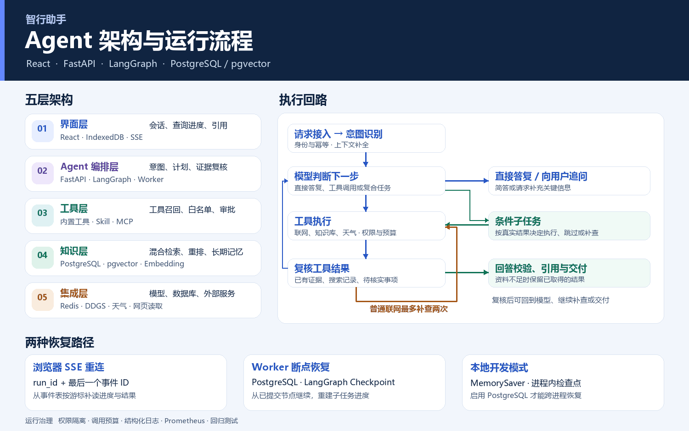

# 智行助手架构与运行流程

## 五层架构

| 层级 | 职责 | 主要实现 |
|---|---|---|
| 界面 | 会话交互、查询进度、引用展示和断流重连 | React、TypeScript、Ant Design X、IndexedDB、SSE |
| Agent 编排 | 请求校验、意图路由、任务拆分、证据复核和回答交付 | FastAPI、LangGraph、Chat Run Worker |
| 工具 | 工具召回、参数校验、调用预算、超时和审批 | 内置工具、Skill、MCP、语义工具检索 |
| 知识 | 文档切片、混合检索、邻居扩展、证据组重排和长期记忆 | PostgreSQL、pgvector、可配置 Cross-Encoder、Embedding Gateway |
| 集成 | 连接模型、数据库、缓存和外部数据源 | 模型适配器、PostgreSQL、Redis、DDGS、可选 DeepSeek Fetch、天气与 MCP 服务 |

## 执行回路

~~~mermaid
flowchart TD
    User["用户提问"] --> API["FastAPI · 请求校验"]
    API --> Intent["LangGraph · 意图识别与上下文补全"]
    Intent -->|直接答复或需要澄清| Output["回答交付 · SSE"]
    Intent -->|普通问答、联网或工具任务| Model["上下文预算与模型节点"]
    Intent -->|显式知识库请求| Knowledge["准备知识库检索"]
    Knowledge --> Tools["工具执行 · 权限、预算、超时"]
    Model -->|发起工具调用| Tools
    Model -->|形成草稿| Quality["回答校验与引用整理"]
    Tools --> Review["根据结果判断下一步"]
    Review -->|补查缺失证据| Tools
    Review -->|资料足够或可部分回答| Model
    Review -->|需要用户补充| Output
    Model -->|复合任务| Plan["判断前置条件，执行下一子任务或定向补查"]
    Plan -->|还有可执行子任务| Tools
    Plan -->|计划执行完毕| Quality
    Quality --> Output
~~~

- **普通联网查询**：首批之后，模型根据已有摘录、搜索记录和待核实事项选择补查、追问或交付。最多补查两次，受整轮工具额度和 50 个去重网页的上限约束。补查未增加可用摘录或查询词重复时，使用已有资料并说明缺口。
- **条件复合任务**：先检查真实工具结果。例如预报显示下雨才搜索室内景点。公开搜索子任务可在留足其他原始任务额度的前提下补查一次，随后按子任务合并证据。
- **查询进度**：前端可查看实际搜索词、网页结果、页面读取、补查和复合任务状态。最终正文附可点击引用。

## 重连与恢复

| 场景 | 行为 |
|---|---|
| 浏览器连接中断 | 启用持久化聊天任务后，浏览器用 run_id 和最后一个事件 ID 重连，按游标补读事件。 |
| Worker 中断 | 配置 CHECKPOINT_DATABASE_URL 后，新 Worker 从已提交的 LangGraph Checkpoint 继续，并根据保存的计划和工具结果恢复进度。 |
| 本地未配置 PostgreSQL 检查点 | 使用进程内 MemorySaver，恢复范围为当前进程。 |

持久化任务的进度独立写入事件表，工作流节点通过 Checkpoint 保存状态。最终文本事件和任务完成状态在同一个数据库事务内提交。

## 后端编排模块

| 模块 | 职责 |
|---|---|
| [service.py](../../backend/app/agent/service.py) | 初始化依赖、注册节点和连接 LangGraph 流程 |
| [intent_node.py](../../backend/app/agent/intent_node.py) | 上下文补全、意图识别和复合任务计划 |
| [context.py](../../backend/app/agent/context.py) | 上下文预算、窗口选择和历史压缩 |
| [model_node.py](../../backend/app/agent/model_node.py) | 选择候选工具、装配提示词、调用模型 |
| [tool_execution.py](../../backend/app/agent/tool_execution.py) | 执行工具、校验权限、处理审批和搜索预算 |
| [evidence_node.py](../../backend/app/agent/evidence_node.py) | 证据复核、资料缺口判断和补查 |
| [compound_tasks.py](../../backend/app/agent/compound_tasks.py) 和 [plan_progress.py](../../backend/app/agent/plan_progress.py) | 执行条件子任务，并从工具结果重建进度 |
| [answer_node.py](../../backend/app/agent/answer_node.py) | 校验、整理引用和发布回答 |
| [turns.py](../../backend/app/agent/turns.py) 和 [chat_run_worker.py](../../backend/app/api/chat_run_worker.py) | 对话检查点、流式事件和持久化任务恢复 |

## 横向治理

- **安全与隔离**：生产身份认证、知识库 ACL、工具白名单、MCP 审批和不可信资料处理。
- **可靠性**：请求幂等、会话锁、调用预算、超时、有限补查和部分交付。
- **可观测性**：HTTP 请求 ID、后台任务 run_id、结构化日志、Prometheus 指标和 RAG 评估。
- **共享状态**：PostgreSQL 保存持久化聊天任务、检查点和配置后的知识库数据。Redis 支持多实例共享限流和 MCP 审批。
