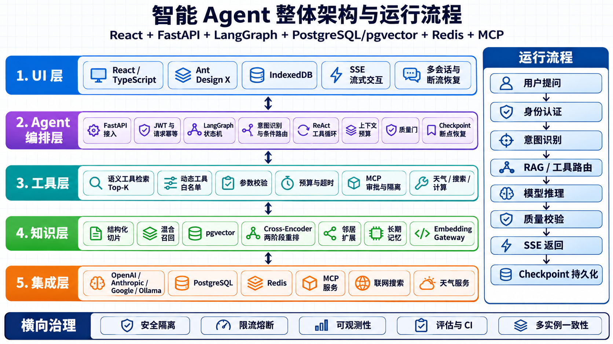
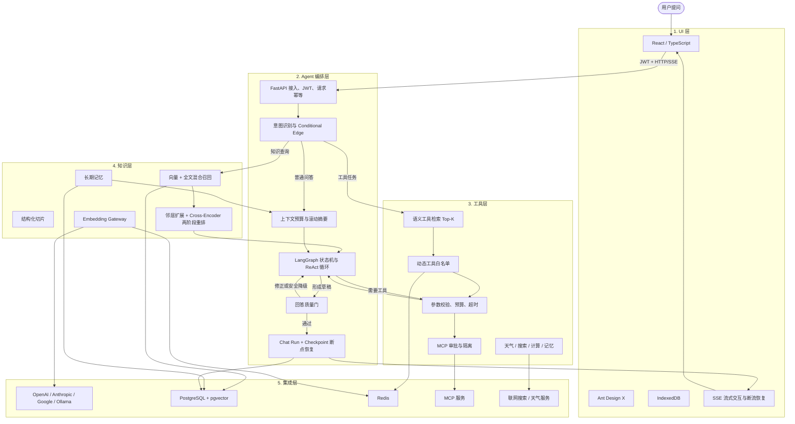

# 智能 Agent 整体架构与运行流程



## 五层职责

| 层级 | 核心职责 | 主要实现 |
|---|---|---|
| UI 层 | 对话交互、会话管理、流式展示、账号隔离与断流恢复 | React、TypeScript、Ant Design X、IndexedDB、SSE |
| Agent 编排层 | 身份与幂等、意图识别、条件路由、ReAct 循环、上下文治理、质量门与断点恢复 | FastAPI、LangGraph、Checkpoint、Chat Run Worker |
| 工具层 | 候选工具召回、动态白名单、参数校验、预算、超时、审批和隔离执行 | 内置工具、Skill、MCP、语义工具检索 |
| 知识层 | 文档切片、混合检索、邻居扩展、证据组重排、长期记忆和 Embedding 治理 | PostgreSQL、pgvector、Cross-Encoder、Embedding Gateway |
| 集成层 | 统一连接模型、数据库、缓存、MCP 和外部公开服务 | OpenAI、Anthropic、Google、Ollama、PostgreSQL、Redis、MCP |

## 可维护架构源图



## 端到端运行流程

```text
用户提问
→ JWT 身份认证与 API Key 校验
→ message_id 请求幂等与会话级锁
→ LangGraph 意图识别
→ RAG、长期记忆或工具候选路由
→ 主模型执行 ReAct 推理循环
→ 引用、事实和工具状态质量校验
→ Chat Run、事件和 Checkpoint 原子持久化
→ SSE 按事件游标返回前端
→ 断流或 Worker 故障后从持久状态恢复
```

## 横向治理

- 安全隔离：JWT 身份、知识 ACL、工具白名单、MCP 审批、Prompt Injection 防护。
- 可靠性：请求幂等、会话锁、断点恢复、超时、重试、限流、熔断和降级。
- 可观测性：Request ID、结构化事件、Prometheus 指标和 RAG 评估报告。
- 多实例一致性：PostgreSQL 持久状态、Redis 分布式限流与审批、Embedding SingleFlight。
- 工程质量：后端单元测试、RAG 回归门禁、前端测试和 GitHub Actions CI。
